# Manual del panel de En Compañía

El panel es el lugar desde donde actualizás la web: la carta, el plato del día, los horarios y las novedades. Funciona en el celular y en la computadora, y **todo lo que guardás se ve en la web al instante**.

Las imágenes de este manual son del celular. En la computadora es lo mismo, con el menú a la izquierda en lugar de abajo.

## 1. Entrar y salir del panel

1. En la web, tocá el ícono de la **persona** que está arriba a la derecha.
2. Escribí tu **email** y tu **contraseña**, y tocá **Ingresar**.
3. Vas a ver el **Inicio** del panel, con accesos rápidos y lo que conviene revisar.

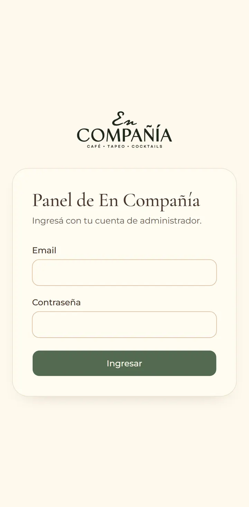

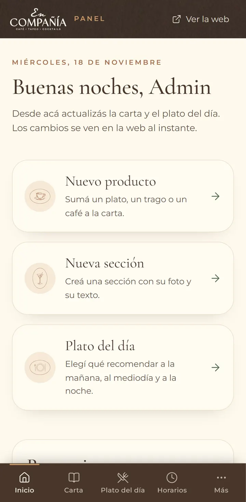

Abajo tenés el menú: **Inicio**, **Carta**, **Plato del día**, **Horarios** y **Más**. En **Más** están **Novedades**, **Mi cuenta**, **Ayuda** (este manual), **Ver la web** y **Cerrar sesión**.

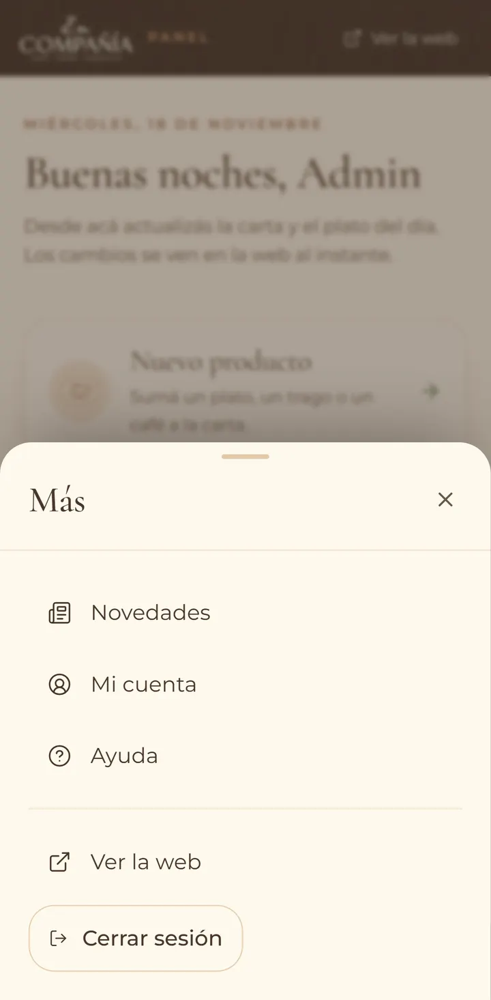

Para **salir**, tocá **Más** y después **Cerrar sesión**. En la computadora, **Cerrar sesión** está abajo, en el menú de la izquierda.

> Tu contraseña es personal: no la compartas. Para cambiarla, entrá a **Más → Mi cuenta**.

## 2. Cambiar un precio

1. Tocá **Carta** y elegí la sección (por ejemplo, **Cafetería**).
2. Cada producto tiene su precio en un casillero. Tocalo, borrá el número y escribí el nuevo, **solo con números** (por ejemplo, 3500).
3. Tocá en cualquier otro lugar de la pantalla (o la tecla de confirmar del teclado). Aparece un aviso que dice que se guardó.

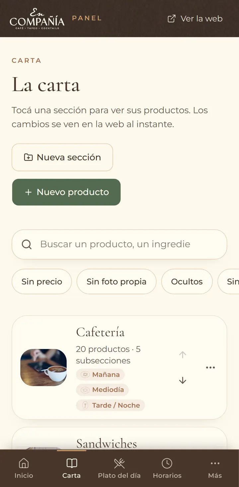

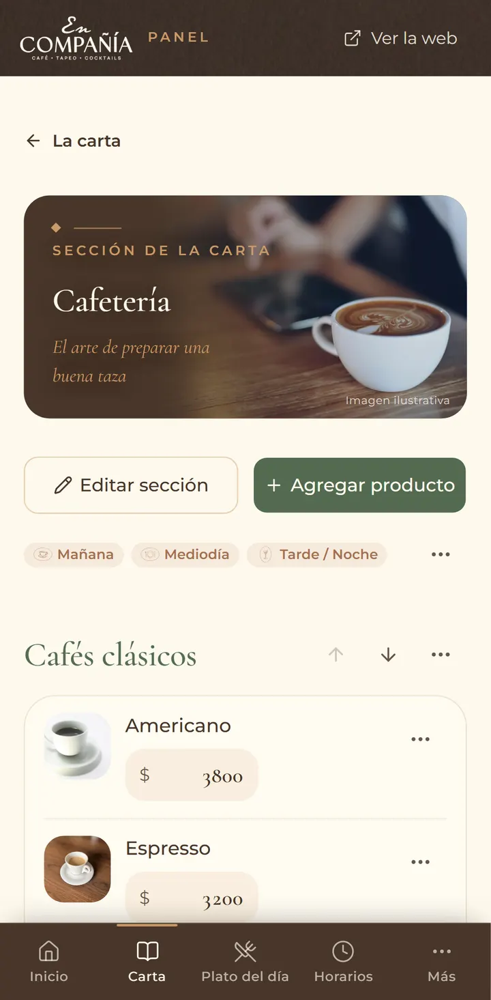

> Si te equivocaste antes de salir del casillero, en la computadora podés tocar la tecla Esc para volver al precio anterior.

## 3. Editar un producto

1. En la sección, tocá los **tres puntos (⋯)** al lado del producto.
2. Elegí **Editar**.
3. Cambiá lo que necesites: la foto, el nombre, la descripción, el precio o los ingredientes.
4. Tocá **Guardar cambios**.

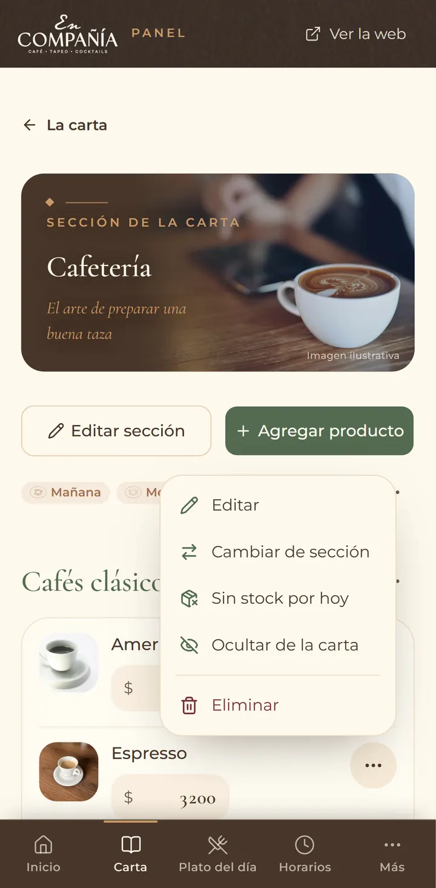

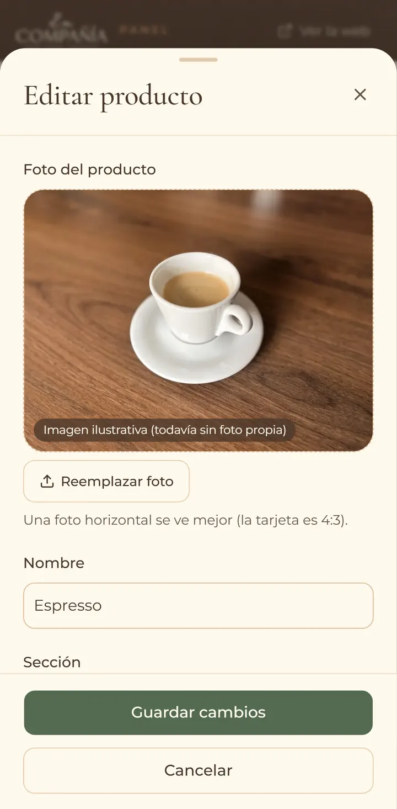

Desde el mismo menú de los tres puntos también podés **cambiar el producto de sección**, **ocultarlo de la carta** (por ejemplo, si es de temporada) o **eliminarlo**.

## 4. Marcar un producto «Sin stock por hoy»

Cuando algo se terminó en el día:

1. Tocá los **tres puntos (⋯)** del producto.
2. Elegí **Sin stock por hoy**.

En la web el producto se sigue viendo, pero atenuado y con la etiqueta **«Sin stock hoy»**. **Al día siguiente vuelve solo**, no tenés que hacer nada.

Si se repuso antes, tocá los tres puntos y elegí **Disponible otra vez**.

> **Sin stock por hoy** no es lo mismo que **Ocultar de la carta**: lo oculto no se ve en la web hasta que vuelvas a tocar **Mostrar en la carta**.

## 5. Crear una sección de la carta

1. Tocá **Carta** y después **Nueva sección**.
2. Subí la **foto del banner** (la imagen grande de la sección), escribí el **título** y, si querés, un **texto breve**.
3. Marcá en qué **momentos del día** se sirve: **Mañana**, **Mediodía** o **Tarde / Noche**.
4. Arriba vas a ver cómo queda. Tocá **Crear sección**.

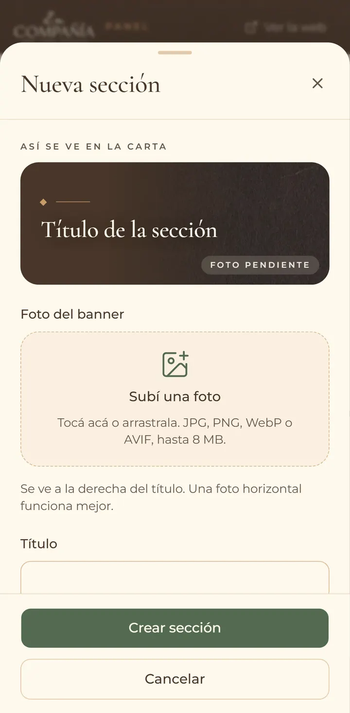

Para agrupar productos dentro de una sección (por ejemplo, «Cafés clásicos»), entrá a la sección y tocá **Nueva subsección**, al final de la pantalla. Las subsecciones no llevan foto.

## 6. Publicar el plato del día

Hay un plato para cada momento: **Mañana**, **Mediodía** y **Tarde / Noche**.

1. Tocá **Plato del día**.
2. En el momento que quieras, tocá **Cargar plato** (o **Editar** si ya tiene uno).
3. Subí la **foto** y escribí el **título**: son obligatorios. Si querés, sumá un subtítulo, un texto, el precio y los ingredientes.
4. Tocá **Vista previa** para ver cómo queda en la web.
5. Tocá **Publicar**. Si todavía no querés que se vea, tocá **Guardar sin publicar**.

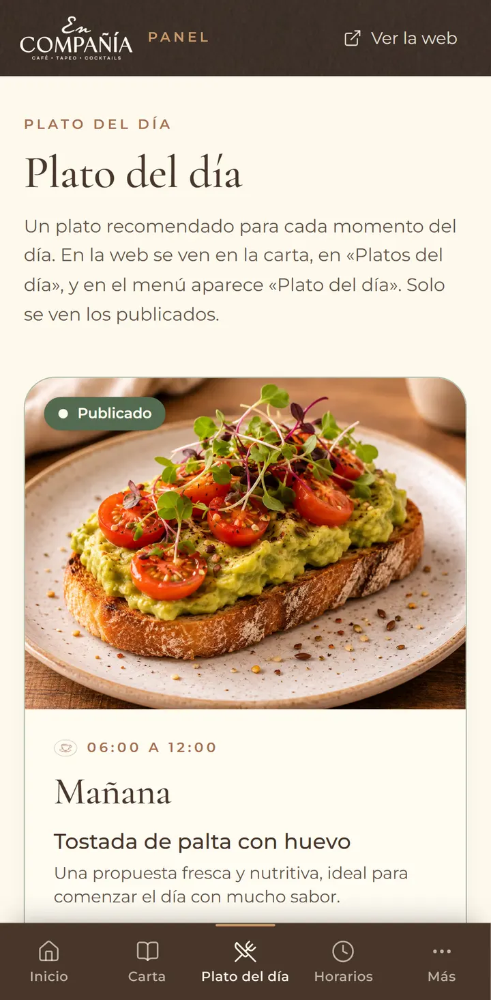

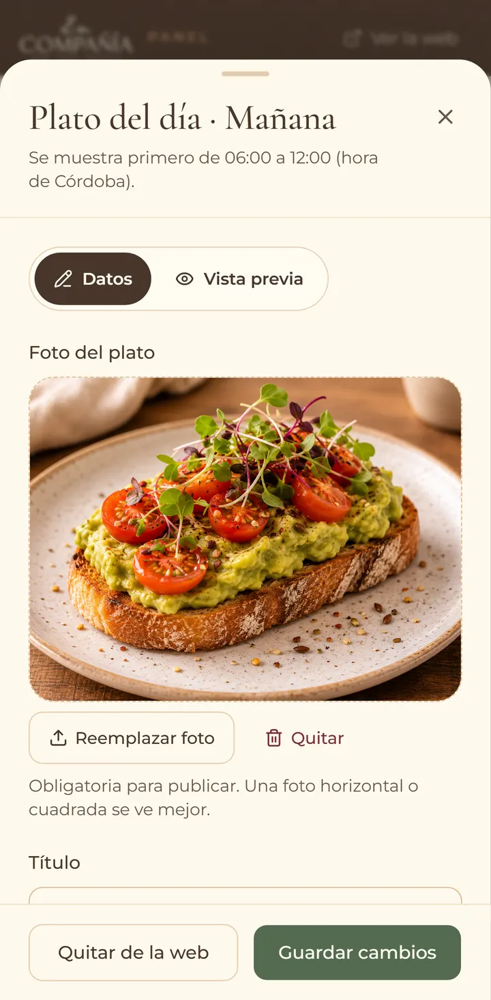

En la web, los platos publicados se ven en la carta, en **Platos del día**, y en el menú aparece **Plato del día**. Para sacarlo, tocá **Quitar de la web** (los datos quedan guardados) o **Vaciar** (se borra todo para cargar uno nuevo).

## 7. Cambiar el horario

1. Tocá **Horarios**.
2. En cada día, el interruptor dice si está **Abierto** o **Cerrado**.
3. Cambiá las horas de **Abre** y **Cierra**. Si un día abre en dos turnos, tocá **Agregar otro horario**.
4. Si cierra **después de las 12 de la noche** (por ejemplo, de 19:00 a 01:00), marcá **Cierra al día siguiente**.
5. Tocá **Guardar horario** (el botón de abajo).

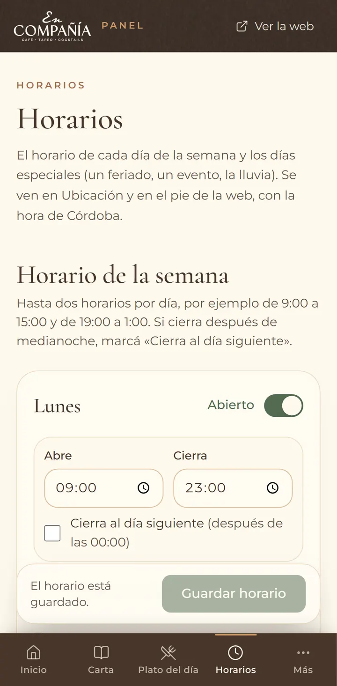

> Para poner el mismo horario en toda la semana, cargalo en un día y tocá **Copiar a todos los días**. Después guardá.

El horario se ve en **Ubicación** (con el día de hoy resaltado) y abajo de todo en la web («Hoy: …»).

## 8. Agregar un día especial

Para un feriado, un evento o un día que cerrás por lluvia:

1. Tocá **Horarios** y bajá hasta **Días especiales**.
2. Tocá **Agregar día especial**.
3. Elegí la **fecha**.
4. Elegí **Cerrado** u **Horario distinto** (y cargá las horas de ese día).
5. Si querés, escribí una **nota para la web**, por ejemplo «Cerrado por lluvia».
6. Tocá **Agregar día especial**.

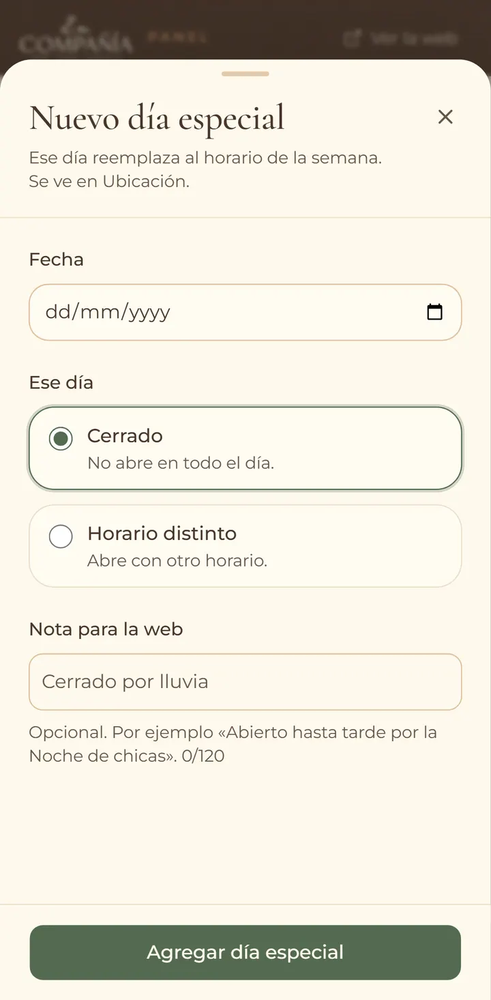

Ese día reemplaza al horario de la semana. En **Ubicación** se ven los días especiales de los próximos 7 días, con su nota. Para cambiarlo o borrarlo, usá **Editar** o **Eliminar** en la lista. Cuando ya pasaron, podés borrarlos todos juntos con **Borrar días que ya pasaron**.

## 9. Publicar una novedad

Para contar un evento, una promoción o una propuesta especial:

1. Tocá **Más** y después **Novedades**.
2. Tocá **Nueva novedad**.
3. Elegí **Foto** o **Video**. Si es un video, subí también una **portada** (una foto): es la imagen que se ve antes de reproducirlo.
4. Escribí el **título** y la **descripción**. Para separar párrafos, dejá una línea en blanco.
5. Si es un evento, elegí la **fecha del evento**. Si querés, escribí un **mensaje final** (por ejemplo, «¡Te esperamos!»).
6. Elegí el **diseño de la tarjeta**: **Dividida**, **Apilada** o **Curva**.
7. Tocá **Vista previa** para ver cómo queda, y después **Publicar**. Si todavía no querés que se vea, tocá **Guardar borrador**.

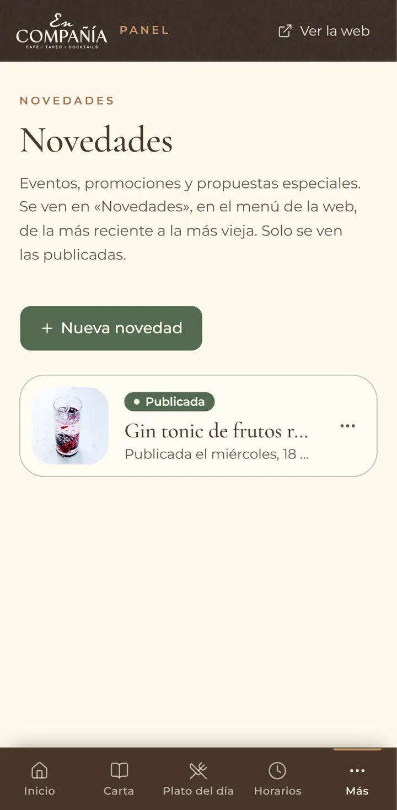

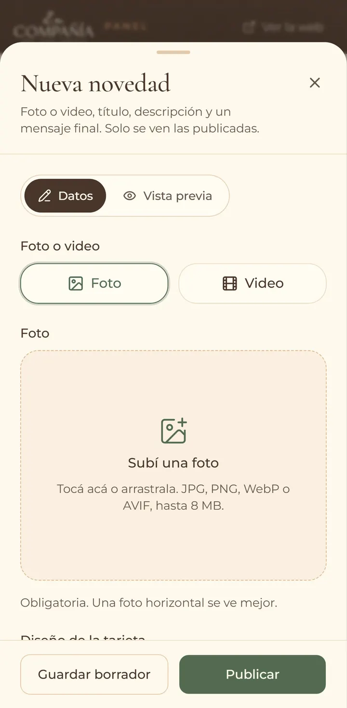

Cada novedad se ve completa en la sección **Novedades** de la web, de la más nueva a la más vieja. Desde los **tres puntos (⋯)** de la lista podés **Editar**, **Publicar u Ocultar**, **Ver en la web** o **Eliminar**.

> **Novedades** aparece en el menú de la web solo cuando hay al menos una publicada.

## 10. Si algo no funciona

- **Algo no se actualiza:** recargá la página (deslizá hacia abajo en el celular o tocá el botón de recargar). Los cambios se ven en la web al instante.
- **Aparece «Tu sesión terminó»:** volvé a ingresar con tu email y tu contraseña.
- **La foto no se sube:** tiene que ser JPG, PNG, WebP o AVIF y pesar hasta 8 MB. Los videos, MP4 o WebM de hasta 50 MB. Revisá también la conexión a internet.
- **No te deja guardar:** leé el mensaje en rojo, te dice qué falta (por ejemplo, la foto o el título).
- **Te olvidaste la contraseña:** pedile a quien administra la web que te genere una nueva. Si podés entrar, la cambiás en **Más → Mi cuenta**.
- **Sigue sin funcionar:** sacá una captura de pantalla, anotá qué estabas haciendo y avisale a quien administra la web.
